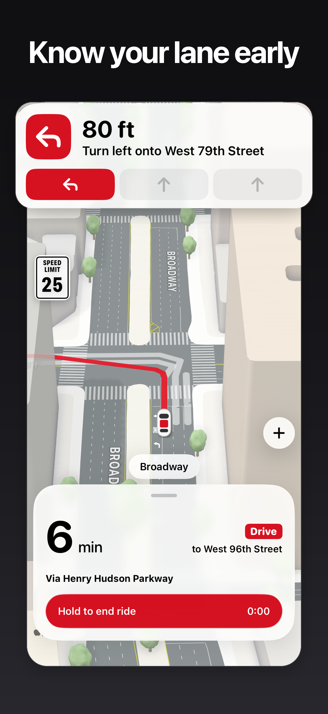
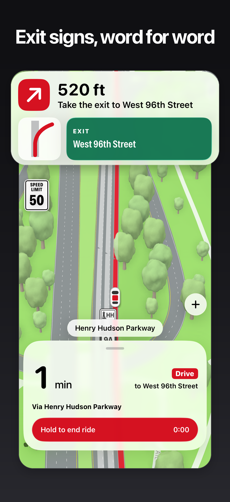
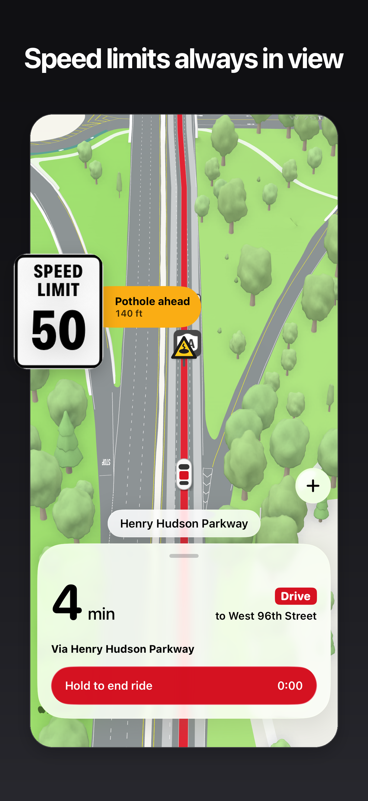
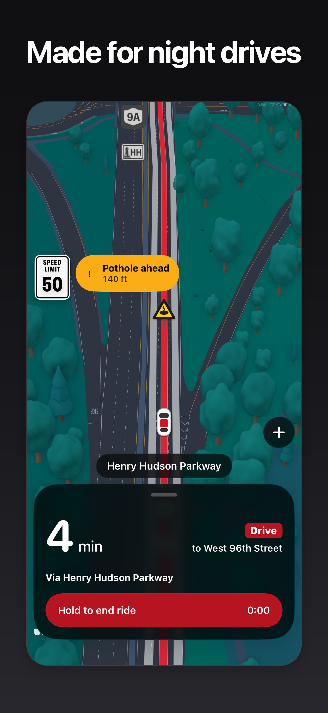
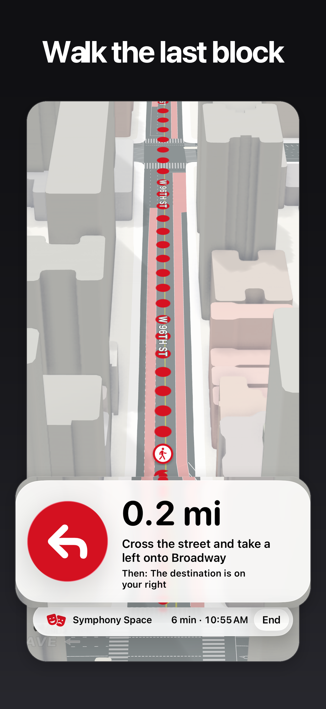

<h1 align="center"> Velo Maps </h1> <br>
<p align="center">
  <a href="https://github.com/divinedavis/Velo-Maps">
    
  </a>
</p>

<p align="center">
  Turn-by-turn navigation with a 3D map, clear lane guidance and real highway signs. Built with SwiftUI and MapKit.
</p>

## Table of Contents

- [Introduction](#introduction)
- [Features](#features)
- [Feedback](#feedback)
- [Build Process](#build-process)
- [How It's Built](#how-its-built)
- [Acknowledgments](#acknowledgments)

## Introduction

Velo Maps is a navigation app for iPhone. It draws your route on Apple's 3D city map with the iOS 26 Liquid Glass look, tells you which lane to be in before a turn, and shows highway entrance and exit signs with their real wording.

**In beta on TestFlight for iPhone.**

<p align="center">
  
</p>

## Features

A few of the things you can do with Velo Maps:

* **3D map** — Apple's realistic 3D city view with a camera that follows the car smoothly through turns, plus a top-down 2D mode.
* **Turn banners that arrive at the right time** — when a banner appears depends on your speed, so you get about a mile of notice on a fast road and a shorter lead in town.
* **Lane guidance** — every lane is drawn, with yours highlighted before a turn or ramp.
* **Highway signs** — entrance and exit signs use the destination wording and exit numbers from OpenStreetMap, never invented text.
* **Speed limits** — shown as a US speed-limit sign, from OpenStreetMap data cached on the device.
* **Live traffic and faster routes** — routes use live traffic when available, and the app keeps checking for a faster route while you drive and switches when the saving is worth it.
* **Spoken directions** — a natural voice for common prompts, falling back to recorded clips and then the iPhone's own voice.
* **Road reports** — one tap to mark a pothole, police, an accident or a closed road.
* **Walking mode** — a simpler glanceable screen for the walk at the end of a trip.
* **Home and search** — an Apple Maps-style sheet with search, recent places and suggestions.

<p align="center">
  
  
  
  
</p>

## Feedback

Feel free to [file an issue](https://github.com/divinedavis/Velo-Maps/issues/new). Feature requests are always welcome.

## Build Process

Requirements: Xcode 26 or later, [XcodeGen](https://github.com/yonaskolb/XcodeGen), and an iOS 26 simulator or device.

```sh
./scripts/generate.sh     # writes VeloMaps.xcodeproj and the local secrets file
open VeloMaps.xcodeproj
```

`generate.sh` creates `VeloMaps/AppSecrets.swift`, which is deliberately not in the repo. Without a token the app still runs: it falls back to recorded voice clips, the iPhone voice and the public routing services.

Run the tests with `./scripts/run_tests.sh` (`unit`, `ui` or `perf` to run one suite).

## How It's Built

| Path | What's in it |
| --- | --- |
| `VeloMaps/` | The app: map views, trip logic, routing, turn banners, signs, voice, settings |
| `VeloMapsTests/` | Unit tests (Swift Testing) |
| `VeloMapsUITests/` | UI tests, including an accessibility audit |
| `server/` | Two small Python services the app talks to: a voice proxy with a cache and daily budget, and a live-traffic routing proxy. Keys stay on the server |
| `scripts/` | Project generation, tests, performance gate, shipping to TestFlight, marketing captures |
| `marketing/` | App icon, screenshots and App Store creative |
| `release_notes/` | What changed in each TestFlight build |

Routing tries live traffic first, then OSRM with alternatives, then Apple's own directions, and uses the fastest result. Every paid service sits behind a server-side proxy with a hard daily cap, so the app itself never holds a provider key.

## Acknowledgments

Map data from Apple MapKit and © OpenStreetMap contributors. Routing by OSRM and Mapbox.
